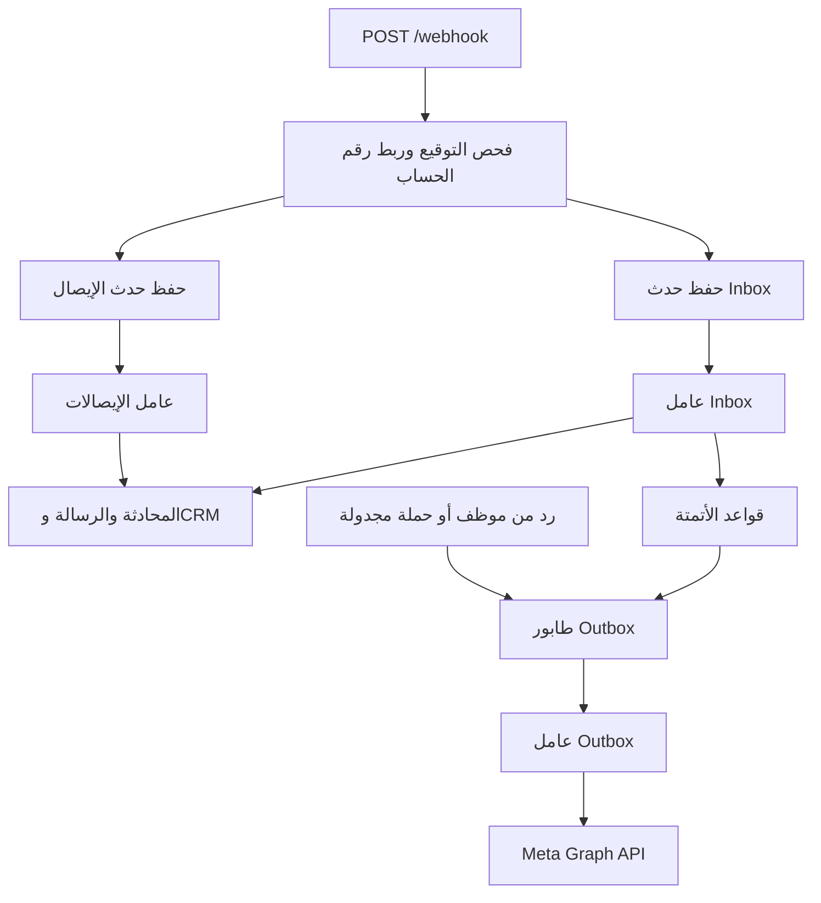

# المعمارية والبيانات

## التطبيق الواحد

`ChatPlatform.csproj` يجمع تطبيق ASP.NET Core 8 وواجهات HTML عربية من `wwwroot/`. يتولى `Program.cs` قراءة الإعدادات وتسجيل الخدمات وتهيئة قاعدة البيانات قبل تشغيل HTTP. تجمع `Endpoints/` نقاط الدخول المشتركة، وتقدم `Controlers/` وحدات MVC حسب الميزة. ينظم `Infrastructure/` التخزين والتكاملات والعمال، ويضم `Core/` عقود الأحداث والمحوّلات.

واجهة المتصفح تستخدم `wwwroot/api.js` لتغليف الطلبات وتطبيق رؤوسها وإظهار الأخطاء. يقرأ تحديث Inbox أرقام المراجعة الخاصة بالمؤسسة من SSE ثم يجلب البيانات عبر REST. يستخدم التحديث الدوري إذا تعذر البث. مسار SignalR القديم محجوب بسياسة الوصول الافتراضية.

## استقبال رسالة واستمرارها حتى الإيصال

1. في GET يتحقق الخادم من الطلب ويعيد نص التحدي. في POST يحدّ حجم الطلب ويفحص HMAC على بايتات الجسم قبل تحليل JSON.
2. يحل `WhatsAppTenantResolver` الرقم إلى حساب ومؤسسة نشطين. تُحفظ الأحداث تحت مفاتيح تمنع التكرار. يعالج Inbox الرسالة ويحفظ نتائج الأتمتة ومسودات الإرسال كوحدة متسقة.
3. تختار واجهة الإرسال الحساب من نطاق الجلسة. يربط `Idempotency-Key` المحاولة بهوية المؤسسة، وتتحقق العملية من حدود الباقة قبل حجز رسالة جديدة.
4. يعيد Outbox فحص الحساب والمؤسسة والاشتراك، ويفحص النافذة إذا كان النوع يتطلبها. تعاد محاولات ضمن سياسة العامل عند الرفض المؤقت الصريح. تسجَّل النتيجة الملتبسة بصيغة `DeliveryUnknown` لتفادي إرسال آلي مكرر.
5. يطابق عامل الإيصالات معرّف Meta والمستلم والحساب والمؤسسة. إيصال متأخر لا يُرجع رسالة من `Read` أو `Delivered` إلى حالة أدنى.

## البيانات

| المجموعة | الجداول أو الكيانات الرئيسية | الغرض |
|---|---|---|
| المؤسسات والهوية | `Tenants`، `PlatformSessions`، `ManagedAgents`، `ManagedTenantAdmins` | نطاق المؤسسة والمستخدمون والجلسات القابلة للإلغاء. |
| قناة واتساب | `WhatsAppTenants`، `DataProtectionKeys` | ربط رقم Meta بمالكه، وتخزين الرموز مشفرة وحفظ مفاتيح الحماية. |
| الرسائل | `WhatsAppWebhookInbox`، `WhatsAppConversations`، `WhatsAppMessages`، `WhatsAppOutbox`، `WhatsAppStatusInbox` | أحداث الدخول والمحادثات والردود المحجوزة وإيصالات التسليم. |
| العملاء والبث | `CrmContacts`، `InboxRevisions` | ملفات العملاء وإشارات تجديد صندوق المحادثات لكل مؤسسة. |
| الأتمتة | `AutoReplyRules`، `BotDrafts`، `BotReleases`، `ConversationAutomation`، `AutomationRuns` | قواعد تقليدية ومسودات وإصدارات وحالة انتظار/تحويل وسجل تنفيذ. |
| القوالب والمعرفة | `WhatsAppTemplates`، `KnowledgeArticles` | قوالب الرسائل ومقالات منشورة أو مسودات قابلة للبحث المحلي. |
| التسويق والاشتراكات | `MarketingEntities.cs`، `SubscriptionEntities.cs` | الموافقات والقوائم والحملات والباقات والاشتراكات وسجلها الإداري. |

يحدد `PlatformDbContext` نماذج EF Core والعلاقات والفهارس. يتولى `DbInitializer` إنشاء الجداول وتوافق المخططات القديمة في بدء التشغيل. من أمثلة التوافق توحيد تاريخ حساب واتساب ونسخ الرمز القديم للحساب النشط عند الحاجة. يوجد ملف SQL مرجعي لتاريخ الرسائل الدائمة في `Infrastructure/Data/Migrations/`. المسار التشغيلي الحالي هو المُهيِّئ عند الإقلاع.

## العزل والصلاحيات

- جلسة المتصفح `__Host-ChatPlatform` محمية بـ `Secure` و`HttpOnly` و`SameSite=Strict`، تدوم 30 دقيقة، ويُراجع سجلها في SQLite. تعيين الدور أو المؤسسة يكون من الهوية الموثقة. إيقاف حساب أو مؤسسة وإعادة ضبط كلمة المرور تلغي الجلسات المعنية.
- سياسة الوصول الافتراضية تمنع المسارات التي لا تحدد سياسة معتمدة أو سماحًا صريحًا. تطبّق سياسات `TenantRead` و`TenantAdmin` و`PlatformOwner` قيودها على الخادم. يتطلب كل طلب تغيير تحت `/api` الرأس `X-ChatPlatform-CSRF: 1` ويخضع لفحص مصدر المتصفح.
- المسارات العامة التشغيلية تشمل الصحة والجاهزية والـWebhook، وتُخدم صفحات تسجيل الدخول والسياسات وملفات الواجهة الثابتة من التطبيق. بيانات مساحة العمل تأتي من APIs محمية. تتطلب جلسة المستخدم وواجهات النشر HTTPS.
- إدارة الباقة تعطي صلاحيات التشغيل لمدير المنصة. بيانات العملاء تتطلب هوية `Admin` أو `Agent` في المؤسسة. إسناد محادثة تنظيمي داخل المؤسسة.
- نموذج الذكاء المملوك للمنصة اختياري ومعطل افتراضيًا. يرسل معاينة يدوية وسياقًا محدودًا من المقالات المنشورة إلى عنوان المضيف المصرح به باستخدام العقد `chatplatform.own-model.v1`.

[مرجع الملفات والكلاسات](source-map.md) يربط كل وحدة بموضعها في المستودع. [مرجع API](api.md) يوضح المسارات الفعلية وسياساتها.
